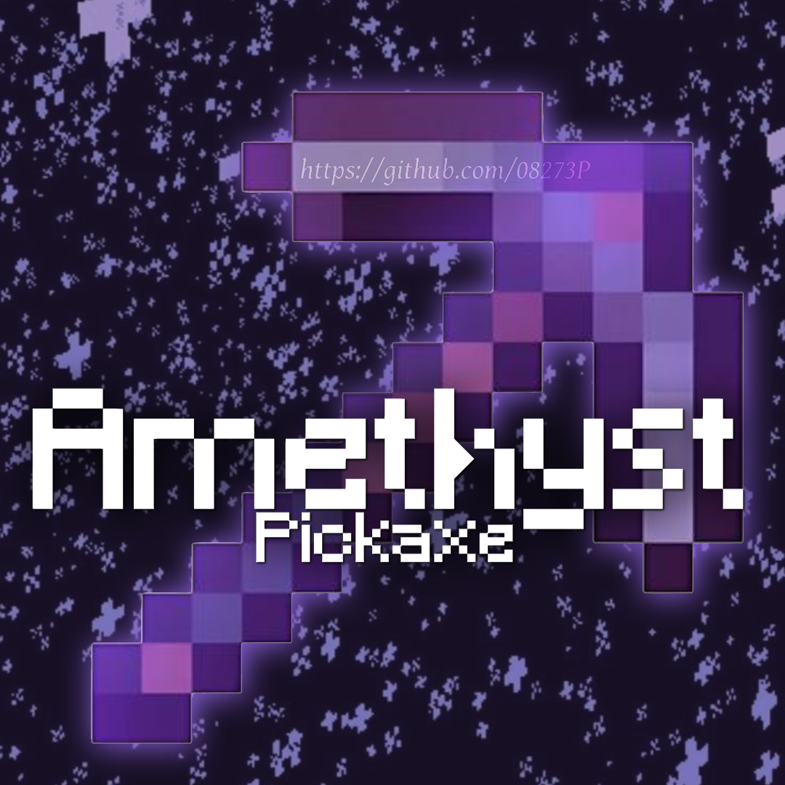

<p align="center">
  
</p>

<h1 align="center">AmethystPickaxe</h1>

<p align="center">A 3x3 amethyst pickaxe with custom durability for Paper servers.</p>

<p align="center">
  <a href="https://github.com/08273P/AmethystPickaxe/raw/main/AmethystPickaxe.jar">
    
  </a>
</p>

<p align="center">
  <a href="https://papermc.io">
    
  </a>
</p>

## Features

- Mines a 3x3 area based on the face you hit
- Custom durability, costs 1 per 3x3 mined
- Can't be renamed, enchanted, or repaired
- Optional auto-pickup, hidden silk touch, particles, sounds, and glint
- Update notice for OPs

## Install

1. Download `AmethystPickaxe.jar`
2. Drop it in your `plugins` folder
3. Restart the server
4. Run `/amethystpickaxe`

## Good to know

Needs Paper 1.21+ and Java 21.

```
/amethystpickaxe                      give it to yourself
/amethystpickaxe <player>             give it to a player
/amethystpickaxe <player> <durability> give it with a custom max durability
/amethystpickaxe reload               reload the config
```

Permission: `amethyst.pickaxe` (OP by default). To give it to a rank or player with LuckPerms:

```
/lp user Steve permission set amethyst.pickaxe true
```

Everything else is in `plugins/AmethystPickaxe/config.yml`.

---

<p align="center">All Rights Reserved · Made by <a href="https://github.com/08273P">08273P</a></p>
